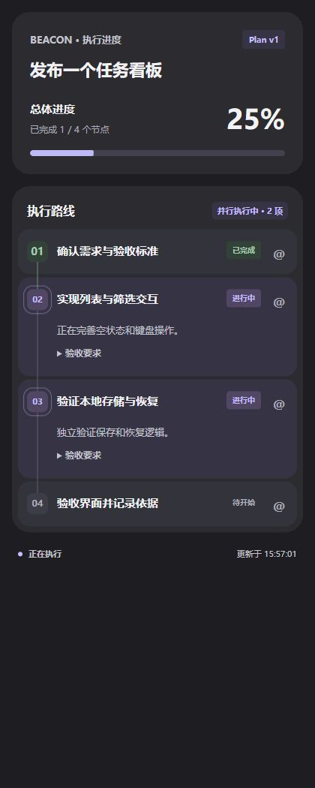
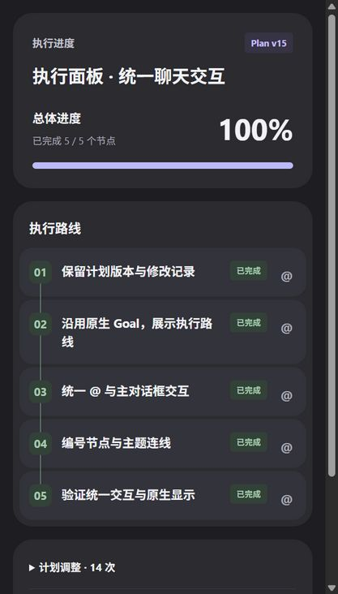
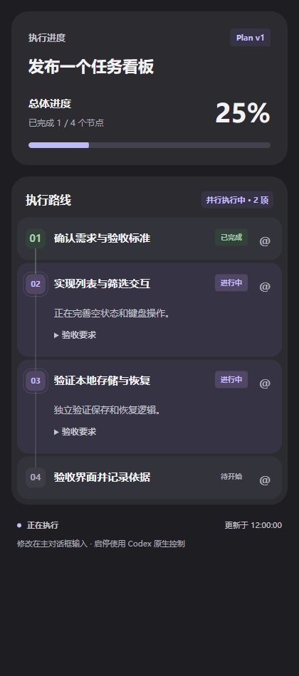
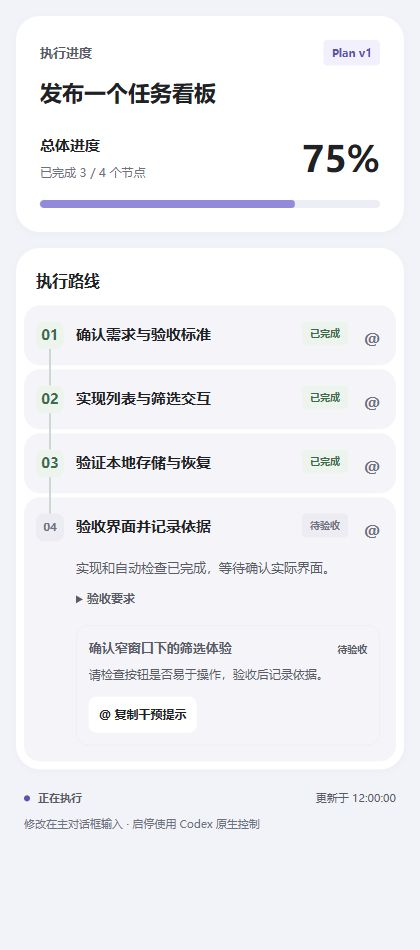
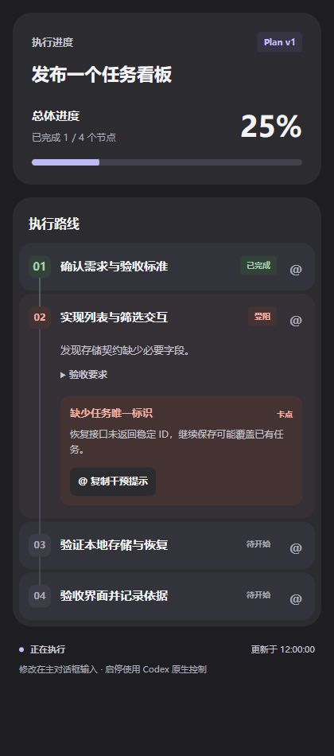

# Codex Beacon

**让 Codex 的执行过程，看得见，也插得上手。**

An open-source MCP sidebar for Codex: track plan progress, surface blockers, and bring any step into your chat draft with **@**.

[English](README.en.md) · [安装](docs/installation.md) · [贡献](CONTRIBUTING.md) · [反馈](https://github.com/liuzhengxiang666/codex-beacon/issues) · [MIT](LICENSE)

**Preview · v0.5.3** — 社区项目，与 OpenAI 无隶属关系。当前重点验证 Windows 桌面客户端；跨客户端适配欢迎贡献。

原名 **Codex Execution Panel**。仓库现在是 `codex-beacon`，显示名为 **Beacon 执行面板**；原 MCP 名称、marketplace 名称和技能 ID 保持兼容，已有安装无需新增服务或迁移任务数据。

## v0.5.3 更新

- 增加 `auto` / `ask` / `manual` 首次选择，复用用户级 `AGENTS.md` 保存偏好。
- 生命周期 hooks 根据实际步骤提醒打开面板，覆盖开发、检索、跨聊天核对等多步任务；它们提供执行上下文，**不保证宿主强制展开右栏**。
- 统一 Beacon 品牌，去掉面板底部的操作说明，保留简洁的节点与 @ 入口。

<p align="center"></p>

*新版截图来自实际运行的隔离演示页面；不包含真实聊天数据，也不代表新的原生自动展开验收。*

## 为什么做这个

Codex 开始执行一个长任务后，你是否也经常想问：**现在做到哪了？卡在哪里？我想修改其中一步，该怎么说？**

这个面板把主要计划节点、完成进度和需要关注的事项放进右侧，让主对话继续输出。点任意节点的 @，对应上下文就会进入当前聊天草稿，补充要求后再发送。

<p align="center"></p>

*上图来自真实 Codex 原生右栏，为本项目开发完成时的实际界面；没有把面板嵌入正文。下方状态示例使用独立演示数据运行同一套界面，不是真实用户会话。*

## 你能得到什么

- **看进度**：编号节点、总体完成比例、执行中状态；满足依赖的多个节点实际执行时显示轻量并行提示。
- **看问题**：区分卡点、待决定、分支和中性的待验收。待验收不会冒充受阻，但仍阻止虚报完成。
- **接着改**：所有节点都支持 @，包含待开始、进行中、完成和取消；事项也可以单独引用。
- **留住上下文**：计划版本、变更原因、稳定节点 ID、完成依据和历史归档。
- **保持专注**：单列岛屿布局，跟随客户端明暗主题；进度来自实际节点计数，动效支持减少动态效果设置。
- **本地运行**：Python 标准库、SQLite 和原生 HTML/CSS/JavaScript，无 npm 构建、API Key 或独立数据库服务。

## 安装

需要 Python **3.10+**、Codex CLI，以及支持本地 MCP Apps 的 Codex 桌面客户端。Node **20+** 只用于运行前端测试。

```powershell
git clone https://github.com/liuzhengxiang666/codex-beacon.git
cd codex-beacon
# 只向你的 Codex 配置注册这份源码，不会自动重启客户端
./scripts/register-mcp.ps1
codex plugin marketplace add .
codex plugin add execution-panel@codex-execution-panel
```

注册时选择默认方式：多步任务自动开、每次询问或手动开。已有设置会保留，也可运行 `python scripts/configure-panel.py --mode auto` 明确选择。macOS / Linux 请在安装技能后运行该命令。

重新加载连接；若当前客户端没有重载入口，退出并重新打开客户端。首次使用或更新 hooks 后，在 Codex CLI 的 `/hooks` 审核并信任当前定义；脚本不绕过信任流程。手动入口为 **@Beacon 执行面板**，也可以说“打开当前任务的执行面板”。

如果执行策略阻止 PowerShell 脚本，请使用[手动注册步骤](docs/installation.md)，不需要更改系统执行策略。macOS / Linux 安装命令也在该文档中，但这些平台的原生右栏尚未完成实机验证。

这是**本地 MCP + 技能入口**的安装方式，不是官方插件目录上架。技能包不再注册第二个 MCP。保持克隆目录位置稳定，移动后重新注册服务器路径。

## 怎么使用

1. 告诉 Codex 要完成的多步任务；技能会引导它维护主要成果节点并请求打开右栏。
2. 在右栏查看节点和问题，继续在主对话框协作。
3. 想调整某一步，点该节点右侧 **@**，补充“修改这里的验收要求……”后自行发送。

草稿导入需要宿主明确支持该能力、且聊天身份匹配。否则按钮提供复制；没有确认时提示“未确认”，不会自动重试。导入固定使用 `active + send=false`，不会自动发送消息或新建聊天。

你也可以直接说：“修改第 3 项”“第 3 项验收后停下”。需要立即停止时，使用 Codex 自己的停止按钮。

## 状态示例

| 执行与并行 | 待验收 | 真实卡点 |
| --- | --- | --- |
|  |  |  |

这些图片来自实际运行的本地演示预览。演示使用虚构任务，与当前聊天及真实 Codex 日志隔离；[自行运行演示](docs/development.md#独立演示)。原生 @ 导入需要在真实宿主里验证，预览页的复制成功不能替代它。

## 能力边界

| 能力 | 当前行为 |
| --- | --- |
| 自动更新 | Agent 通过 MCP 上报主要节点；另从可识别的本地结构化日志补充运行状态。不会从任意正文猜进度。 |
| 默认打开右栏 | 按已保存偏好，由技能与 hooks 提醒 Agent 请求原生面板，宿主决定如何呈现。历史 Windows 验收确认过工具调用后展开；v0.5.3 hooks 在无 @ 新任务中必定自动展开仍未完成端到端验收。 |
| 总体百分比 | 有效主要节点的完成数比例，取消项不计；不等于耗时估算，也不等于 Goal 完成。 |
| 并行提示 | 展示已上报且依赖满足的执行状态，不会自行启动多个 Agent。 |
| Goal 模式 | 可展示同一任务的 Plan；Goal 仍负责持续执行与启停。没有独立 Goal 状态订阅或控制器。 |
| @ 草稿 | 依赖宿主扩展，始终由用户决定发送；不支持时复制。 |
| 语言 | 当前界面与技能主要使用中文；英文界面欢迎贡献。 |

## 开发与贡献

```sh
python -B -m unittest discover -s tests -q
node --test tests/test_bridge.mjs tests/test_theme.mjs tests/test_plan_model.mjs tests/test_panel_ui.mjs
```

详见[开发说明](docs/development.md)、[贡献指南](CONTRIBUTING.md)、[架构与工具](docs/architecture.md)、[验证记录](docs/validation.md)和[隐私说明](docs/privacy.md)。欢迎提交可复现的问题、体验建议、文档修正，以及跨平台适配。UI PR 请附**实际运行截图**。

## 致谢与许可

本项目采用 [MIT License](LICENSE)。MCP Apps 桥接改编自 [Codex Trajectory](https://github.com/icesixgod/codex-trajectory)，保留其 MIT 归属；[Claude Code Agent Monitor](https://github.com/hoangsonww/Claude-Code-Agent-Monitor) 提供了计划可视化研究参考，未复制其任务进度实现。详见 [THIRD_PARTY_NOTICES](THIRD_PARTY_NOTICES)。
